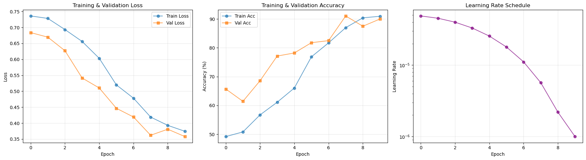
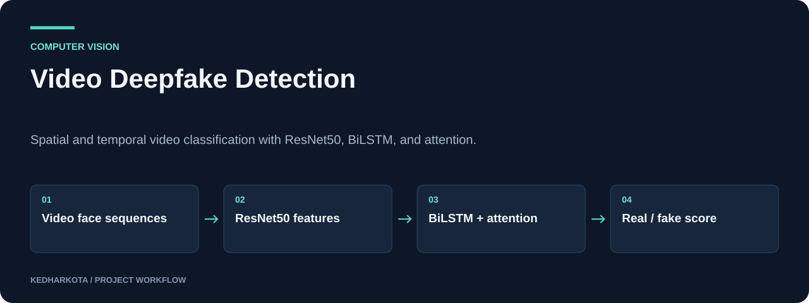
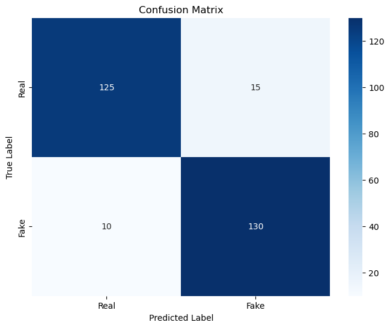

# Video Deepfake Detection

Spatial and temporal video classification with ResNet50, BiLSTM, and attention.

**Python · PyTorch · OpenCV · MediaPipe · ResNet50**

[Overview](#overview) · [Getting started](#getting-started) · [Repository guide](#repository-guide) · [Reproducibility](docs/REPRODUCIBILITY.md)



*Original training and validation plots saved in the notebook.*

## Overview

A deepfake-detection notebook that models both appearance and temporal information in video face sequences. It combines a ResNet50 backbone with a multi-layer bidirectional LSTM, attention, and a classifier, then explores transfer learning on additional videos.

## What this project includes

- Face extraction and fixed-length video sequence preparation.
- ResNet50 feature extraction with temporal modeling and multi-head attention.
- Mixed-precision training, gradient clipping, and scheduled learning rates.
- Training-history visualization, confusion-matrix evaluation, transfer learning, and single-video inference.

## Workflow



*Explanatory diagram. Detailed implementation and availability notes follow below.*

## Getting started

Use Jupyter with a compatible PyTorch/torchvision environment. The notebook imports NumPy, pandas, tqdm, OpenCV, MediaPipe, Matplotlib, seaborn, and scikit-learn in addition to PyTorch.

Open `advanced_resnet_lstm_deepfake.ipynb`, review the configuration cell, replace local real/fake video and checkpoint paths, and execute the data-processing sections before training. CUDA is recommended for the full model; pretrained ResNet weights require a model download.

### Required inputs and current constraints

Supply the real and manipulated video datasets expected by the configuration. The repository does not include the videos, trained weights, or a dependency lockfile. Keep the evaluation split at the video/source level when reporting generalization; sequences from the same video are correlated.

## Repository guide

| File | Purpose |
| --- | --- |
| [advanced_resnet_lstm_deepfake.ipynb](advanced_resnet_lstm_deepfake.ipynb) | Complete preprocessing, model, training, evaluation, and inference workflow. |

## Results and project status

The figures included here are original saved outputs from the committed notebook, showing training history and a confusion matrix. They describe that saved run and were not regenerated here. The notebook's '>90%' statement is a target, and these results do not establish performance on arbitrary unseen video sources.



*Original notebook output. No new training run was performed.*

## Next steps

- Record dataset provenance, source-video split rules, and random seeds.
- Publish a compact evaluation summary and versioned checkpoint metadata.

## Documentation maintenance

Local documentation links and image headers are checked on pull requests and relevant pushes by the [documentation workflow](.github/workflows/docs.yml). Run the same check locally:

```bash
python tools/check_docs.py
```

See the [reproducibility guide](docs/REPRODUCIBILITY.md) for evidence, missing artifacts, and visual-source notes. The check validates documentation files; it does not train models or certify application behavior.

---

[More projects by kedharkota](https://github.com/kedharkota?tab=repositories)
